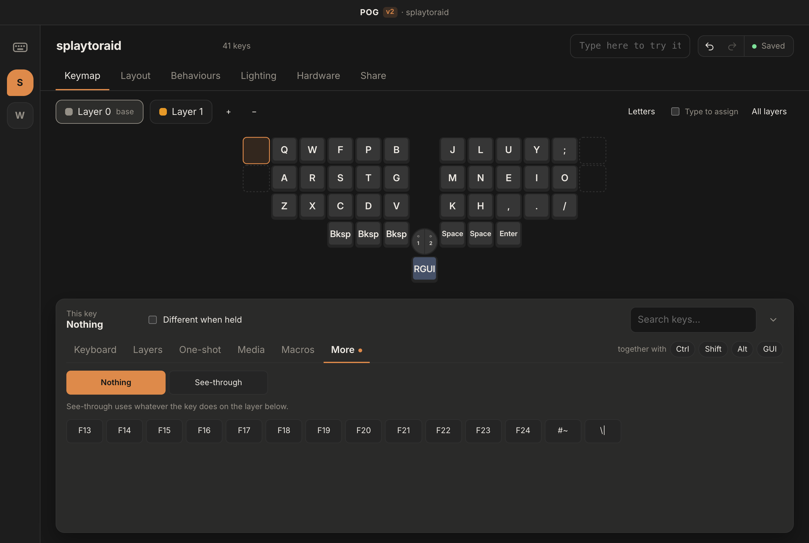

<p align="center"></p>
<h1 align="center">JMK + POG v2</h1>
<h4 align="center">
Keyboard firmware you configure after flashing, and the app that does it
</h4>

> **Built with a lot of AI help.** I design this, decide what goes in and test
> it on my own keyboards, but most of the code was written with AI coding
> tools and not typed by hand.



**JMK** is the keyboard firmware written in Rust. You flash one prebuilt file, and pins,
wiring, keymap and everything else are set from the app afterwards and kept
on the keyboard. No config files, no compiling. you can export this state but the goal is that it is so simple to setup from scratch that you arent worrying about them.

**POG v2** is that app (`app/`). It is the follow-up to
[POG](https://github.com/JanLunge/pog), which did the same job for KMK.

The idea: flash a hand-wired board, press every key once so the app can work
out how it is wired, and start typing. built for keyboard builders and designers so they can iterate without thinking about the firmware or KLE

# Status

Early alpha. The protocol and the saved
format can still change. I use it on macOS and Ubuntu. I dont test on windows myself unless absolutely needed. though we have community menbers usign it succesfully on windows

What has actually run on hardware:

| | |
| --- | --- |
| RP2040 (Pi Pico and friends) | Runs on my own boards. This is the one to use. |
| RP2350 (Pi Pico 2 and friends) | Compiles, from the same code as the RP2040. Has not run on a board yet. |
| nRF52840 (nice!nano and friends) | Compiles. will wireup my first bluetooth board soon with it (wireless is not supported yet). |
| Split keyboards over a cable | Works both with 2 pin and 1pin serial connections |
| widirng types | Direct pin, matrix, duplex matrix and rotary encoders work |
| RGB lights (WS2812) | RP2040 only (RP2350: built in, not tried). |

# What it does

- finds the wiring from key presses: one pin per key, a matrix with or
  without diodes, a duplex matrix, or a mix of them on one board
- rotary knobs, split keyboards over a serial cable, RGB underglow and
  per-key lights
- layers, hold-tap, combos, one-shot modifiers, macros you can record
- keymap editor: click or drag keys, or just type on your normal keyboard to
  fill in key after key
- puts QWERTY, Colemak, Colemak-DH or Dvorak on the letter keys in one go
- layout editor for where the keys sit, with keyboard-layout-editor import
- every change is saved to the keyboard by itself, with undo and redo
- one file holds the whole keyboard (wiring, layout, keymap, lights) to back
  it up or set up the next one
- firmware update from the app in one click, no reset button, both halves of a split
- virtual keyboards that run the real firmware logic, so you can try all of
  it without hardware

# Try it

You need [Rust](https://rustup.rs) and Node.js.

```sh
rustup target add wasm32-unknown-unknown
cd app
npm install
npm run start
```

Pick a virtual keyboard on the first screen, or plug in a board.

For a real Pi Pico build the firmware first, then hold BOOTSEL while
plugging it in. The app offers to install it.

```sh
rustup target add thumbv6m-none-eabi
(cd firmware/rp2040 && cargo build --release)
cargo run -p jmk-uf2 -- rp2040 \
    firmware/rp2040/target/thumbv6m-none-eabi/release/jmk-rp2040 target/jmk-rp2040.uf2
(cd app && npm run firmware)
```

For a Pi Pico 2 it is the same with `rp2350` and its target:

```sh
rustup target add thumbv8m.main-none-eabihf
(cd firmware/rp2350 && cargo build --release)
cargo run -p jmk-uf2 -- rp2350 \
    firmware/rp2350/target/thumbv8m.main-none-eabihf/release/jmk-rp2350 target/jmk-rp2350.uf2
(cd app && npm run firmware)
```

`./scripts/check.sh` runs every test and builds all firmwares. There is no
hosted CI yet, that script is it.

How the crates fit together, the pin safety rules and the protocol notes are
in [docs/internals.md](docs/internals.md).

# Tasks

## bugs and rough edges
- [ ] the keymap picture cannot be zoomed, big boards get small
- [ ] a duplex matrix can show a key that is not held with four or more keys down (true for the wiring itself, but untested on a real one)
- [ ] setting up a split with only one half plugged in restores only that half from a keyboard file
- [ ] the macro recorder cannot see shortcuts the system takes for itself
- [ ] the setups key presses need a bit of time because we check all variants so type slowly (i want to speed this up)

## next
- [ ] releases with installers for macOS, Windows and Linux
- [ ] CI that runs the check script
- [ ] run the nRF52840 port on a real board
- [ ] run the RP2350 port on a real board
- [ ] test duplex and mixed wiring on real boards

## wishlist
- [ ] split halves over Bluetooth
- [ ] more than one Bluetooth host, and a pairing mode
- [ ] tap dance
- [ ] key labels for German and other host layouts
- [ ] a wiring preview while soldering
- [ ] a registry for sharing keyboards and keymaps (was started, taken out until it works)

# License

[Apache License 2.0](LICENSE).

