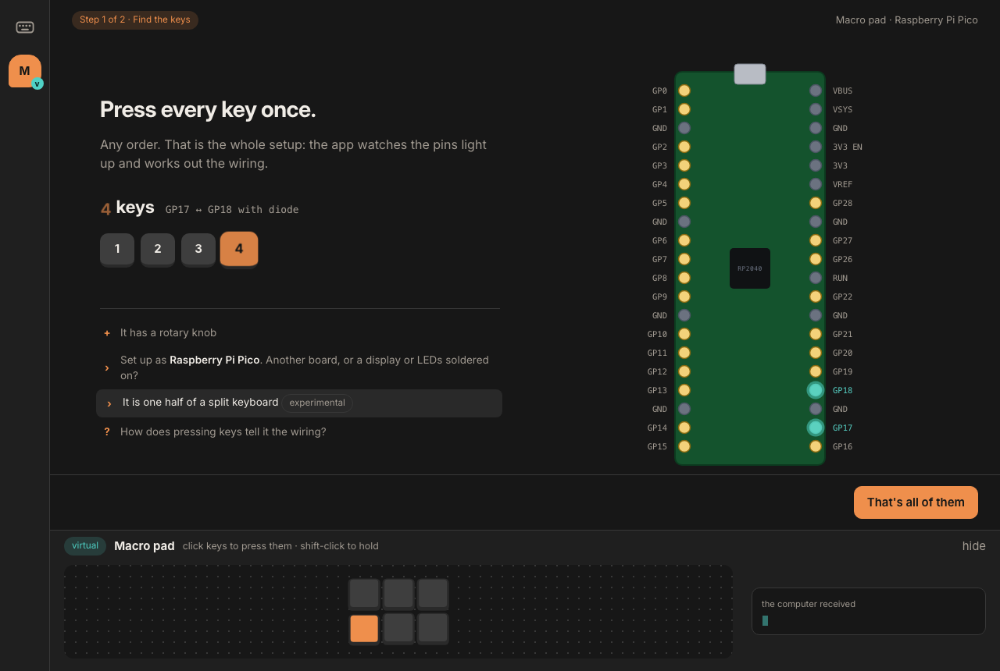

# JMK

**JMK** is keyboard firmware in Rust that is configured after flashing, not
before compiling. **POG** is the app that configures it.

- **JMK, the firmware.** One prebuilt image per microcontroller family.
  Pins, matrix type, keymap and behaviours are not compiled in; they are
  set from the app and stored on the keyboard.
- **POG, the configurator.** This is POG version 2: the POG app, rebuilt
  to run on JMK firmware. It lives in `app/`.

The aim is that someone with a hand-wired board flashes a file, presses
each key once so the app can work out the wiring, and is done.

> **Early alpha.** Tested on Ubuntu and macOS. There are no releases or
> installers yet, and the protocol and saved configuration format may still
> change.



## Try it

No keyboard is needed: the app includes virtual keyboards that run the real
firmware logic on simulated wiring.

You need [Rust](https://rustup.rs) with the `wasm32-unknown-unknown` target
and Node.js.

```sh
rustup target add wasm32-unknown-unknown
cd app
npm install
npm run start     # builds and opens the desktop app
```

On the home screen pick a virtual keyboard at the bottom, or plug in a
board. `npm run wasm && npm run dev` runs the same app in a Chromium browser
instead.

For a real Raspberry Pi Pico, build the firmware first (this needs the
`thumbv6m-none-eabi` target), then hold BOOTSEL while plugging the board in.
The desktop app offers to install onto it, or copy `target/jmk-rp2040.uf2`
to the drive that appears yourself.

```sh
rustup target add thumbv6m-none-eabi
(cd firmware/rp2040 && cargo build --release)
cargo run -p jmk-uf2 -- rp2040 \
    firmware/rp2040/target/thumbv6m-none-eabi/release/jmk-rp2040 target/jmk-rp2040.uf2
(cd app && npm run firmware)   # lets the desktop app install it
```

## What works today

- **Firmware for RP2040** (Raspberry Pi Pico and similar), run on a real
  Pico: USB keyboard and media keys, configuration channel, saving to flash,
  self-update from the app or command line.
- **Firmware for nRF52840** (nice!nano and similar) with USB and Bluetooth.
  Experimental; see
  [firmware/nrf52840/README.md](firmware/nrf52840/README.md).
- **Wiring**: diode matrix in either direction, one pin per key, rotary
  knobs. Pins are assigned at run time.
- **Keymap engine**: layers, hold-tap in three flavours, combos, one-shot
  modifiers, macros.
- **RGB lights** (WS2812 and compatible) on the RP2040: one chain on any
  free pin, as underglow (spread around the keyboard to begin with), one
  light per key, or both. The two groups have their own effect, colour and
  brightness, and a power limit caps the whole chain.
- **Split keyboards** over a serial cable, with the keymap on the half that
  plugs into the computer. With both halves on USB the app finds which pins
  the cable is on by itself. Experimental: keyboards in one piece are the
  supported kind for now.
- **POG** (`app/`), the configurator, and the second version of POG: a
  setup wizard that finds the wiring from key presses, layout editor, keymap
  editor (pick from an ordinary keyboard or drag onto a key; a colour per
  layer), a picture of all layers to save for printing, hold-tap, combos,
  macros, lighting, a scratch pad for trying the keys, firmware update,
  keyboard files and a registry browser. Includes virtual keyboards that
  run the real firmware logic, for trying it without hardware.
- **Registry server** (`server/`) for sharing keyboard definitions and keymaps.

## Layout

| Path | What it is |
| --- | --- |
| `crates/jmk-core` | Keymap engine. No hardware knowledge. |
| `crates/jmk-proto` | Configuration data model and the wire protocol. |
| `crates/jmk-device` | Scanning, wiring detection, split link, flash storage and request handling, written against small pin, flash and link traits. |
| `crates/jmk-sim` | Simulated wiring, flash and cable; virtual keyboards. |
| `crates/jmk-wasm` | The above compiled for the configurator. |
| `crates/jmk-embassy` | What the ports share: USB interfaces, queues, main loop, split cable. |
| `firmware/rp2040` | The RP2040 port (Embassy). |
| `firmware/nrf52840` | The nRF52840 port with Bluetooth. Experimental. |
| `app/` | POG, the configurator. See its README. |
| `server/` | The registry server for shared keyboards, keymaps and firmware. See its README. |
| `tools/cli` | `jmk`, a command-line client for the protocol (Linux). |
| `tools/uf2` | Turns a firmware ELF file into a UF2 image. |

A port for a new chip implements `jmk_device::Pins`, supplies a flash driver
and connects the transports. Everything else is shared.

## Pin safety

The firmware starts with no pins in use and touches none until told to. It
only ever drives a pin low, and only pins named in the hardware
configuration or offered to the wiring detection. Pins marked as protected
(display, LEDs, power) are refused for both. Detection uses the internal
weak pull resistors, so two probed pins cannot drive against each other.
The light chain's data pin is the one exception: the firmware drives it
high and low, and only the pin the user names for it; that pin is refused
for keys and for detection.
Finding the cable between two halves works the same way: one half holds a
pin low while the other half's detection watches, and the app first rules out
pins tied to supply voltage.

## Build and test

```sh
./scripts/check.sh    # all tests, firmware build, app tests
```

There is no hosted CI; this script is the gate. It needs the Rust targets
`wasm32-unknown-unknown`, `thumbv6m-none-eabi` and `thumbv7em-none-eabihf`,
Node.js, and libclang for the nRF52840 build. It leaves the firmware images
in `target/` (`jmk-rp2040.uf2`, `jmk-nrf52840.uf2`). Hold BOOTSEL while
plugging the board in and copy the file to the drive that appears. A board
already running JMK is updated
with `cargo run -p jmk-cli -- flash target/jmk-rp2040.uf2` or from the app.
The image assumes 2 MB of flash and keeps the saved configuration in the
last 32 KiB.

## Protocol stability

`Request::GetInfo` and `Request::Reboot` keep their wire positions for ever,
so any configurator can identify and update any firmware. Everything else
may still change until the first release; new requests go at the end.

## License

Licensed under the [Apache License 2.0](LICENSE).
